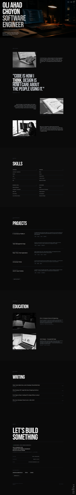

# Oli Ahad Choyon | Portfolio

## Preview



A dark, cinematic personal portfolio website for Oli Ahad Choyon — a Computer Science & Engineering graduate and software engineer based in Dhaka, Bangladesh. The site showcases his professional profile, skills, projects, education, writing, and contact details in a modern, minimal, motion-driven experience.

## Overview

This project is a single-page portfolio built with React and Vite using TypeScript and Tailwind CSS. It follows a visually strong editorial aesthetic with large typography, layered overlays, soft motion, and a dark monochrome design intended to feel polished and premium.

## Highlights

- Full-screen hero section with bold personal branding
- About section with experience and design philosophy
- Skills overview across languages, frontend, backend, and UI/UX
- Selected project showcase with technology tags and external links
- Education and self-learning background
- Writing/blog section for personal articles and notes
- Contact section with email, GitHub, LinkedIn, and CV CTA
- Responsive, mobile-friendly layout
- Smooth animations using Framer Motion

## Tech Stack

- React 18
- Vite
- TypeScript
- Tailwind CSS
- Framer Motion
- React Router
- shadcn-style UI primitives and utility patterns
- Lucide icons and supporting UI libraries

## Project Structure

```text
src/
├── components/
│   ├── About.tsx
│   ├── Contact.tsx
│   ├── Education.tsx
│   ├── Hero.tsx
│   ├── Navigation.tsx
│   ├── Skills.tsx
│   ├── Work.tsx
│   ├── Writing.tsx
│   └── ui/
├── pages/
│   ├── Index.tsx
│   └── NotFound.tsx
├── App.tsx
├── main.tsx
├── index.css
└── lib/
public/
├── hero-image.jpg
├── education-cs.jpg
├── favicon.ico
└── robots.txt
```

## Getting Started

### Prerequisites

- Node.js 18+
- npm or bun

### Install dependencies

```bash
npm install
```

### Run locally

```bash
npm run dev
```

Then open the local Vite URL in your browser, typically:

```text
http://localhost:5173
```

### Build for production

```bash
npm run build
```

### Preview production build

```bash
npm run preview
```

## Scripts

```json
{
  "dev": "vite",
  "build": "vite build",
  "build:dev": "vite build --mode development",
  "lint": "eslint .",
  "preview": "vite preview"
}
```

## Contact

- Email: oiahadchoyon@gmail.com
- GitHub: https://github.com/oiahadchoyon
- LinkedIn: https://linkedin.com/in/oiahadchoyon

## License

This project is a personal portfolio and is intended for showcasing work and professional information.

